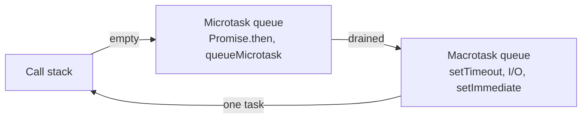

<div align="center">


# 🟨 Topic 1.1 — Advanced JavaScript (ES6+)

### Modules (CJS vs ESM) · Classes · Closures · async/await · Event loop · Microtasks & macrotasks

### Assignment 1.1: build `js-fundamentals`, a plain Node.js lab with async utilities and runnable event-loop demos


</div>

---

## 📑 Contents

| Part | Topic |
|------|-------|
| [0](#0-concepts-read-first) | Modules, classes, closures, async/await, event loop |
| [A](#part-a-project-setup--esm-modules) | `js-fundamentals` project + ESM modules |
| [B](#part-b-async-utilities) | `sleep`, `retry`, `withTimeout`, `pool` |
| [C](#part-c-event-loop-ordering-lab) | Predict and prove event-loop ordering |
| [D](#part-d-closures--classes) | Closure counter + class with private fields |
| [📤](#-what-to-submit) | Submission and marking |

> Node.js 22+ and no bundler needed. The Moodle **Node.js Modules** file covers CJS/ESM in depth. Here you apply it.
>
> ```bash
> mkdir js-fundamentals && cd js-fundamentals
> git init && git checkout -b assignment-1.1
> ```

---

## 0. Concepts (read first)

### CommonJS vs ES Modules

| | CommonJS (CJS) | ES Modules (ESM) |
|---|----------------|------------------|
| Syntax | `require()` / `module.exports` | `import` / `export` |
| Loading | Synchronous, at runtime | Static analysis, async-capable |
| Top-level `await` | No | Yes |
| Tree-shaking | Hard | Yes (bundlers rely on it) |
| `__dirname` | Built in | Use `import.meta.dirname` (Node 20.11+) |
| Enable in Node | default for `.cjs` | `"type": "module"` or `.mjs` |

Browsers and Vite/React code are **ESM**. Prefer ESM everywhere in this course.

### Closures
A function that **remembers variables from the scope where it was created**, even after that scope has returned. They power factories, memoization, private state, and React hooks.

### Classes
Syntactic sugar over prototypes: `constructor`, `extends`, `static`, `#private` fields, getters/setters.

### async/await
`async` functions return a **Promise**. `await` pauses *that function* (not the thread) until the promise settles. Errors surface via `try/catch`.

### The event loop

JavaScript runs on **one thread**. Async work is queued and drained by the event loop:



| Queue | Examples | Runs |
|-------|----------|------|
| Sync | normal code | immediately |
| **Microtasks** | `Promise.then`, `await` continuation, `queueMicrotask` | after the current task, **before** the next macrotask |
| **Macrotasks** | `setTimeout`, `setInterval`, I/O callbacks | one per loop turn |

Node adds `process.nextTick` (runs even before promise microtasks) and `setImmediate` (check phase).

---

## Part A: Project setup & ESM modules

```bash
npm init -y
npm pkg set type=module
npm pkg set scripts.start="node src/index.js" scripts.test="node --test"
mkdir src test
```

`src/async-utils.js` (you will fill this in Part B):

```js
export const sleep = (ms) => new Promise((resolve) => setTimeout(resolve, ms));
```

`src/index.js`:

```js
import { sleep } from './async-utils.js';

console.log('start');
await sleep(100); // top-level await works in ESM
console.log('done after 100ms');
```

Create a tiny CJS twin to compare: `src/legacy.cjs` with `module.exports = { add: (a, b) => a + b }`, then load it from ESM:

```js
import { createRequire } from 'node:module';
const require = createRequire(import.meta.url);
const { add } = require('./legacy.cjs');
```

---

## Part B: Async utilities

Extend `src/async-utils.js`:

```js
export const sleep = (ms) => new Promise((r) => setTimeout(r, ms));

export async function retry(fn, { retries = 3, delayMs = 100 } = {}) {
  let lastError;
  for (let attempt = 0; attempt <= retries; attempt++) {
    try {
      return await fn(attempt);
    } catch (err) {
      lastError = err;
      if (attempt < retries) await sleep(delayMs * 2 ** attempt); // exponential backoff
    }
  }
  throw lastError;
}

export function withTimeout(promise, ms) {
  let timer;
  const timeout = new Promise((_, reject) => {
    timer = setTimeout(() => reject(new Error(`Timed out after ${ms}ms`)), ms);
  });
  return Promise.race([promise, timeout]).finally(() => clearTimeout(timer));
}

// Run async tasks with at most `limit` in flight
export async function pool(tasks, limit = 2) {
  const results = new Array(tasks.length);
  let next = 0;
  async function worker() {
    while (next < tasks.length) {
      const i = next++;
      results[i] = await tasks[i]();
    }
  }
  await Promise.all(Array.from({ length: Math.min(limit, tasks.length) }, worker));
  return results;
}
```

`test/async-utils.test.js`:

```js
import { test } from 'node:test';
import assert from 'node:assert/strict';
import { retry, withTimeout, pool, sleep } from '../src/async-utils.js';

test('retry succeeds after failures', async () => {
  let calls = 0;
  const result = await retry(async () => {
    if (++calls < 3) throw new Error('flaky');
    return 'ok';
  }, { retries: 3, delayMs: 5 });
  assert.equal(result, 'ok');
  assert.equal(calls, 3);
});

test('withTimeout rejects slow work', async () => {
  await assert.rejects(withTimeout(sleep(200), 20), /Timed out/);
});

test('pool preserves order', async () => {
  const out = await pool([1, 2, 3].map((n) => async () => { await sleep(10); return n; }), 2);
  assert.deepEqual(out, [1, 2, 3]);
});
```

Run `npm test` — all green.

---

## Part C: Event-loop ordering lab

`src/event-loop.js`:

```js
console.log('1 sync start');

setTimeout(() => console.log('6 macrotask: setTimeout 0'), 0);
setImmediate(() => console.log('7 macrotask: setImmediate'));

Promise.resolve().then(() => console.log('4 microtask: promise.then'));
queueMicrotask(() => console.log('5 microtask: queueMicrotask'));
process.nextTick(() => console.log('3 nextTick'));

(async () => {
  console.log('2 sync inside async fn (before first await)');
  await null;
  console.log('5b microtask: after await');
})();

console.log('2b sync end');
```

1. **Predict** the output order on paper *before* running `node src/event-loop.js`.
2. Run it and compare. Note: `setTimeout 0` vs `setImmediate` order can vary from the main module. Explain why.
3. Add a second script `src/starvation.js` showing a microtask loop that blocks timers:

```js
let n = 0;
setTimeout(() => console.log('timer never fires while microtasks recurse'), 0);
function spin() { if (n++ < 1e5) queueMicrotask(spin); else console.log('microtasks done'); }
spin();
```

---

## Part D: Closures & classes

`src/closures.js`:

```js
export function makeCounter(start = 0) {
  let count = start; // private via closure
  return { inc: () => ++count, dec: () => --count, get value() { return count; } };
}

export function memoize(fn) {
  const cache = new Map();
  return (arg) => (cache.has(arg) ? cache.get(arg) : (cache.set(arg, fn(arg)), cache.get(arg)));
}
```

`src/task-queue.js`:

```js
export class TaskQueue {
  #items = [];
  static #created = 0;

  constructor(name) { this.name = name; TaskQueue.#created++; }
  static get created() { return TaskQueue.#created; }

  push(task) { this.#items.push(task); return this; }
  get size() { return this.#items.length; }

  async runAll() {
    const results = [];
    for (const task of this.#items) results.push(await task());
    this.#items = [];
    return results;
  }
}
```

Add tests for `makeCounter`, `memoize` (call count), and `TaskQueue` (order + `size` after `runAll`).

---

## 📤 What to submit

1. Repo/PR with `js-fundamentals/` (`src/`, `test/`, `package.json` with `"type": "module"`)  
2. Screenshot of `npm test` passing and the output of `event-loop.js`  
3. `NOTES.md` with your **predicted vs actual** order for Part C  
4. Short answers: CJS vs ESM (two differences); why `await` doesn't block the thread; why microtasks run before `setTimeout(…, 0)`  

## 🧮 Marking (10)

| Criteria | Marks |
|----------|:-----:|
| ESM setup + CJS interop | 1 |
| Async utilities (`retry`, `withTimeout`, `pool`) with tests | 3 |
| Event-loop script + predicted vs actual explanation | 3 |
| Closures + class with private fields (tested) | 2 |
| Short answers | 1 |

### ⭐ Bonus (+2)
Add `AbortSignal` support to `retry` and `withTimeout` so callers can cancel in-flight work.

---

<div align="center">

🚀 **Topic 1.1**  ·  [Topic 1.2 ➡️](../1.2%20UI%20Frameworks%20-%20React/README.md)

</div>
