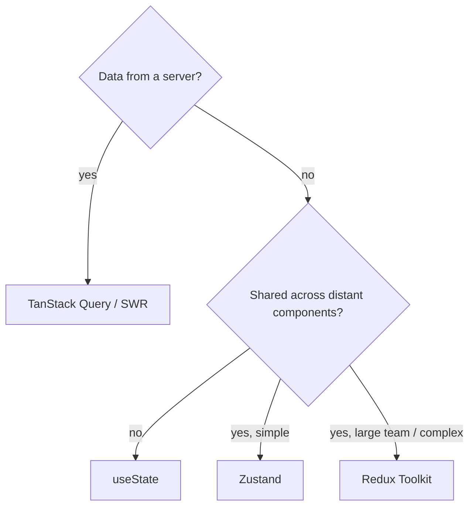

<div align="center">


# 🧠 Topic 1.4 — State Management

### Server state vs client state · TanStack Query / SWR · Redux Toolkit · Zustand

### Assignment 1.4: add TanStack Query to `frontend-lab` for fetching users (public API or mock) and optional Zustand for UI state


</div>

---

## 📑 Contents

| Part | Topic |
|------|-------|
| [0](#0-concepts-read-first) | Server vs client state; Query/SWR vs Redux vs Zustand |
| [A](#part-a-queryclient-setup) | `QueryClientProvider` + DevTools |
| [B](#part-b-fetch-users-with-usequery) | API layer + `useQuery` (loading/error/success) |
| [C](#part-c-mutations--cache-invalidation) | `useMutation` + invalidation |
| [D](#part-d-zustand-for-ui-state-optional) | Zustand store for UI state |
| [📤](#-what-to-submit) | Submission and marking |

> Continue in `frontend-lab`. Use [JSONPlaceholder](https://jsonplaceholder.typicode.com/users) (public, read-only) or a mock with `json-server`. Later swap the base URL to the Unit 2 `users-api`.
>
> ```bash
> git checkout -b assignment-1.4
> npm install @tanstack/react-query @tanstack/react-query-devtools
> ```

---

## 0. Concepts (read first)

### Two kinds of state

| | Server state | Client (UI) state |
|---|--------------|-------------------|
| Lives | On a server; you hold a **cached copy** | Only in the browser |
| Examples | Users, orders, posts | Modal open, selected tab, sidebar collapsed |
| Problems | Staleness, caching, dedup, retries, refetch | Sharing across components |
| Tool | **TanStack Query / SWR** | `useState`, Context, **Zustand**, Redux |

Most "global state" in real apps is actually **server state**. Solve that first and little remains.

### Choosing a tool

| Tool | Strength | Use when |
|------|----------|----------|
| **TanStack Query** | Caching, background refetch, dedup, retries, mutations, pagination | Any REST/GraphQL data (default choice) |
| **SWR** | Smaller, simpler stale-while-revalidate | Light data fetching needs |
| **Redux Toolkit (RTK)** | One predictable store, devtools, time-travel, middleware, RTK Query | Large teams, complex cross-cutting client state, strict conventions |
| **Zustand** | ~1 KB, no providers, hook-based | Small/medium client state (UI flags, cart, filters) |
| `useState` / Context | Built in | Local or low-frequency state (theme, auth) |



### Query vocabulary
- **Query key**: cache identity, e.g. `['users']`, `['users', id]`  
- **staleTime**: how long data is "fresh" (no refetch). **gcTime**: how long unused cache is kept  
- **Invalidate**: mark stale so active queries refetch  
- Automatic: retries (3×), refetch on window focus / reconnect, request dedup

### Redux Toolkit in 10 lines (concept only)

```js
import { configureStore, createSlice } from '@reduxjs/toolkit';

const counter = createSlice({
  name: 'counter', initialState: { value: 0 },
  reducers: { inc: (s) => { s.value += 1; } },   // Immer allows "mutation"
});
export const { inc } = counter.actions;
export const store = configureStore({ reducer: { counter: counter.reducer } });
```

You are **not** required to install Redux, but you must be able to say when you would.

---

## Part A: QueryClient setup

`src/main.jsx`:

```jsx
import { QueryClient, QueryClientProvider } from '@tanstack/react-query';
import { ReactQueryDevtools } from '@tanstack/react-query-devtools';

const queryClient = new QueryClient({
  defaultOptions: { queries: { staleTime: 30_000, retry: 1 } },
});

createRoot(document.getElementById('root')).render(
  <StrictMode>
    <QueryClientProvider client={queryClient}>
      <BrowserRouter>{/* ThemeProvider, AuthProvider, <App /> */}</BrowserRouter>
      <ReactQueryDevtools initialIsOpen={false} />
    </QueryClientProvider>
  </StrictMode>,
);
```

---

## Part B: Fetch users with `useQuery`

`src/api/users.js` (the only place that knows the URL):

```js
const BASE = import.meta.env.VITE_API_URL ?? 'https://jsonplaceholder.typicode.com';

async function request(path, options) {
  const res = await fetch(`${BASE}${path}`, {
    headers: { 'Content-Type': 'application/json' },
    ...options,
  });
  if (!res.ok) throw new Error(`HTTP ${res.status}`);
  return res.json();
}

export const fetchUsers = () => request('/users');
export const fetchUser = (id) => request(`/users/${id}`);
export const createUser = (body) => request('/users', { method: 'POST', body: JSON.stringify(body) });
```

`.env.example`: `VITE_API_URL=http://localhost:3000/api` (for `users-api` in Unit 2; adjust paths if different).

`src/hooks/useUsers.js`:

```js
import { useQuery } from '@tanstack/react-query';
import { fetchUsers, fetchUser } from '../api/users.js';

export const useUsers = () => useQuery({ queryKey: ['users'], queryFn: fetchUsers });
export const useUser = (id) => useQuery({ queryKey: ['users', id], queryFn: () => fetchUser(id), enabled: !!id });
```

`src/pages/Users.jsx`:

```jsx
export default function Users() {
  const { data: users, isPending, isError, error, refetch, isFetching } = useUsers();

  if (isPending) return <p role="status">Loading users…</p>;
  if (isError) return <p role="alert">Failed: {error.message} <Button onClick={refetch}>Retry</Button></p>;

  return (
    <>
      {isFetching && <small>Refreshing…</small>}
      <ul className="grid gap-4 sm:grid-cols-2 lg:grid-cols-3">
        {users.map((u) => <li key={u.id}><UserCard user={u} /></li>)}
      </ul>
    </>
  );
}
```

Replace the hard-coded data from 1.2/1.3 on the list **and** detail pages. In DevTools, observe: navigating list → detail → back does **not** refetch within `staleTime`. Screenshot the Query DevTools.

---

## Part C: Mutations & cache invalidation

```jsx
import { useMutation, useQueryClient } from '@tanstack/react-query';

export function useCreateUser() {
  const qc = useQueryClient();
  return useMutation({
    mutationFn: createUser,
    onSuccess: (created) => {
      // JSONPlaceholder doesn't persist, so patch the cache; with a real API use invalidateQueries.
      qc.setQueryData(['users'], (old = []) => [...old, created]);
      // qc.invalidateQueries({ queryKey: ['users'] });
    },
  });
}
```

Add an "Add user" form (name, email) using it, with disabled-while-`isPending` submit and an inline error message. Explain in your notes why `invalidateQueries` is preferred when the server is the source of truth.

---

## Part D: Zustand for UI state (optional)

```bash
npm install zustand
```

`src/store/ui.js`:

```js
import { create } from 'zustand';
import { persist } from 'zustand/middleware';

export const useUiStore = create(
  persist(
    (set) => ({
      view: 'grid',                         // 'grid' | 'list'
      search: '',
      setView: (view) => set({ view }),
      setSearch: (search) => set({ search }),
    }),
    { name: 'ui-store', partialize: (s) => ({ view: s.view }) },  // persist only the view
  ),
);
```

Use selectors to avoid extra re-renders: `const view = useUiStore((s) => s.view);`. Add a grid/list toggle and a search box that filters `users` client-side. Keep **server data in Query, UI choices in Zustand**: never copy query results into the store.

---

## 📤 What to submit

1. Repo/PR with Query provider, `api/users.js`, hooks, list + detail + create flow (Zustand optional)  
2. Screenshots: Query DevTools showing cached `['users']`; loading and error states (throttle or break the URL)  
3. Short answers: server vs client state; one reason to choose Redux Toolkit over Zustand; what `staleTime` does  

## 🧮 Marking (10)

| Criteria | Marks |
|----------|:-----:|
| QueryClient setup + API module | 2 |
| `useQuery` with loading / error / success UI | 3 |
| `useMutation` + cache update/invalidation | 2 |
| Zustand UI store, or written justification for omitting it | 1 |
| Short answers + notes | 2 |

### ⭐ Bonus (+2)
Implement an **optimistic update** (`onMutate` / `onError` rollback) for a "favourite user" toggle.

---

<div align="center">

⬅️ [Topic 1.3](../1.3%20Styling%20Systems/README.md)  ·  **Topic 1.4**  ·  [Topic 1.5 ➡️](../1.5%20Build%20Tools/README.md)

</div>
