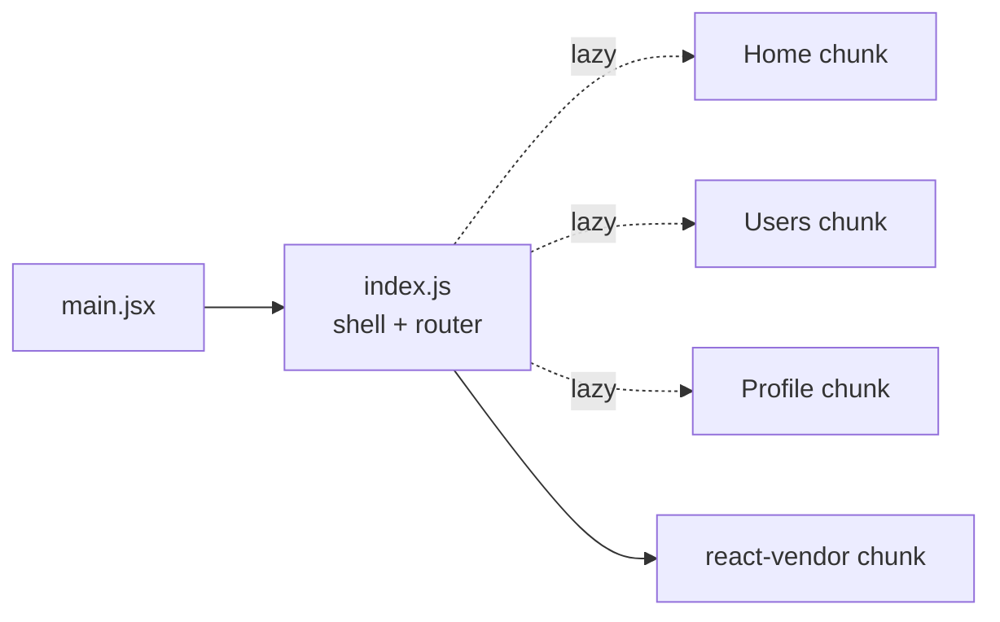

<div align="center">


# 🛠️ Topic 1.5 — Build Tools

### Vite · Webpack concepts · Bundling · Code splitting · Bundle analysis

### Assignment 1.5: configure Vite code splitting (lazy routes), analyze the bundle, and document the build output


</div>

---

## 📑 Contents

| Part | Topic |
|------|-------|
| [0](#0-concepts-read-first) | What a bundler does; Vite vs Webpack; code splitting |
| [A](#part-a-baseline-build) | Baseline production build |
| [B](#part-b-lazy-routes-with-reactlazy) | `React.lazy` + `Suspense` per route |
| [C](#part-c-manual-chunks--analysis) | `manualChunks`, visualizer, size budget |
| [D](#part-d-document-the-build) | `BUILD.md` with before/after table |
| [📤](#-what-to-submit) | Submission and marking |

> Continue in `frontend-lab`.
>
> ```bash
> git checkout -b assignment-1.5
> npm install -D rollup-plugin-visualizer
> ```

---

## 0. Concepts (read first)

### What a bundler does
Starting from an entry file it walks the `import` graph, transforms code (JSX, TS, CSS), **tree-shakes** unused exports, minifies, and emits **hashed static files** (`index-a1b2c3.js`) that browsers and CDNs can cache forever.

### Vite vs Webpack

| | **Vite** | **Webpack** |
|---|----------|-------------|
| Dev server | Native ESM, no bundling, **instant start**, HMR | Bundles everything first (slower on big apps) |
| Production | Rollup (Rolldown in newer versions) | Webpack's own bundler |
| Config | Minimal, sensible defaults | Verbose; powerful loaders/plugins |
| Ecosystem | Modern default for React/Vue/Svelte | Huge legacy base, Module Federation, many enterprise apps |
| Assets | Built in (CSS, images, JSON) | Via loaders (`css-loader`, `babel-loader`) |

Webpack vocabulary you should recognise: **entry**, **output**, **loaders** (transform files), **plugins** (hooks into the build), **chunks**, **`splitChunks`**, `mode`.

### Code splitting
Ship **only the code for the current route**; load the rest on demand.

| Technique | How |
|-----------|-----|
| **Route-based** | `React.lazy(() => import('./pages/Users.jsx'))` |
| **Component-based** | Lazy-load heavy widgets (charts, editors, modals) |
| **Vendor splitting** | Separate `react`, `react-dom` into a long-lived chunk (changes rarely, so cached longer) |
| **Dynamic `import()`** | Standard ESM feature (the bundler turns it into a chunk) |



Trade-off: more chunks mean more requests and possible loading spinners; split on **route boundaries**, not every component.

---

## Part A: Baseline build

```bash
npm run build
npm run preview        # serves dist/ on http://localhost:4173
```

Record the table Vite prints (file names, sizes, gzip sizes) in `BUILD.md` under **Before**. Note the number of JS files and the total gzip size. If everything is in one `index-*.js`, that's your baseline.

---

## Part B: Lazy routes with `React.lazy`

`src/App.jsx`:

```jsx
import { lazy, Suspense } from 'react';
import { Routes, Route } from 'react-router-dom';
import Layout from './components/Layout.jsx';

const Home = lazy(() => import('./pages/Home.jsx'));
const Users = lazy(() => import('./pages/Users.jsx'));
const UserDetail = lazy(() => import('./pages/UserDetail.jsx'));
const Login = lazy(() => import('./pages/Login.jsx'));
const NotFound = lazy(() => import('./pages/NotFound.jsx'));

function PageSpinner() {
  return <p role="status" className="p-8 text-muted">Loading…</p>;
}

export default function App() {
  return (
    <Suspense fallback={<PageSpinner />}>
      <Routes>
        <Route element={<Layout />}>
          <Route index element={<Home />} />
          <Route path="users" element={<Users />} />
          <Route path="users/:id" element={<UserDetail />} />
          <Route path="login" element={<Login />} />
          <Route path="*" element={<NotFound />} />
        </Route>
      </Routes>
    </Suspense>
  );
}
```

> Lazy components need a **default export**. Rebuild and confirm separate `Users-*.js`, `UserDetail-*.js` chunks. In DevTools → Network, verify `Users-*.js` is only fetched when you open `/users`.

**Prefetch on hover** (nice touch):

```jsx
<NavLink to="/users" onMouseEnter={() => import('./pages/Users.jsx')}>Users</NavLink>
```

Also lazy-load one heavy, non-route piece (e.g. a modal or a chart) with a dynamic `import()` triggered by a button click.

---

## Part C: Manual chunks & analysis

`vite.config.js`:

```js
import { defineConfig } from 'vite';
import react from '@vitejs/plugin-react';
import tailwindcss from '@tailwindcss/vite';
import { visualizer } from 'rollup-plugin-visualizer';

export default defineConfig({
  plugins: [
    react(),
    tailwindcss(),
    visualizer({ filename: 'dist/stats.html', gzipSize: true, open: false }),
  ],
  build: {
    sourcemap: true,
    chunkSizeWarningLimit: 250, // kB; fail your own review above this
    rollupOptions: {
      output: {
        manualChunks: {
          'react-vendor': ['react', 'react-dom', 'react-router-dom'],
          query: ['@tanstack/react-query'],
        },
      },
    },
  },
});
```

> If your Vite version uses Rolldown and warns that `manualChunks` is deprecated, use `rolldownOptions.output.advancedChunks` (or `codeSplitting`) instead and note it in `BUILD.md`.

```bash
npm run build && npx vite preview
```

Open `dist/stats.html` (treemap). Identify the **3 largest modules** and propose one action for each (replace, lazy-load, drop, or accept).

Optional environment check: `npx vite build --mode production` vs `--mode development`; explain differences (minification, `import.meta.env.MODE`).

---

## Part D: Document the build

`BUILD.md` must contain:

| Section | Content |
|---------|---------|
| **Before / After table** | file count, total JS (kB), total gzip (kB), largest chunk |
| **Chunk map** | list each emitted chunk → which route/library it holds |
| **Treemap screenshot** | from `dist/stats.html` |
| **Top 3 offenders** | module, size, action |
| **Webpack mapping** | how you would express the same split in `webpack.config.js` (`entry`, `output`, `optimization.splitChunks`), as a snippet, not a working setup |
| **Cache note** | why hashed filenames allow `Cache-Control: immutable` (links to 1.6) |

```js
// webpack.config.js (explanation only)
module.exports = {
  entry: './src/main.jsx',
  output: { filename: '[name].[contenthash].js', clean: true },
  optimization: { splitChunks: { chunks: 'all' } },
  module: { rules: [{ test: /\.jsx?$/, use: 'babel-loader' }, { test: /\.css$/, use: ['style-loader', 'css-loader'] }] },
};
```

---

## 📤 What to submit

1. Repo/PR: lazy routes, `vite.config.js`, `BUILD.md` (do **not** commit `dist/`)  
2. Screenshots: Network panel showing a chunk loading on navigation; treemap  
3. Short answers: why Vite dev starts faster than Webpack; what tree-shaking needs from your code (hint: ESM); why vendor chunks help caching  

## 🧮 Marking (10)

| Criteria | Marks |
|----------|:-----:|
| Baseline build recorded | 1 |
| Lazy routes + `Suspense` fallback working | 3 |
| `manualChunks` + visualizer configured | 2 |
| `BUILD.md` with before/after, chunk map, offenders | 3 |
| Short answers | 1 |

### ⭐ Bonus (+2)
Add a CI-style script that **fails the build** if any JS chunk exceeds your budget (e.g. read `dist/assets` sizes in a small Node script, using skills from 1.1).

---

<div align="center">

⬅️ [Topic 1.4](../1.4%20State%20Management/README.md)  ·  **Topic 1.5**  ·  [Topic 1.6 ➡️](../1.6%20Web%20Performance/README.md)

</div>
