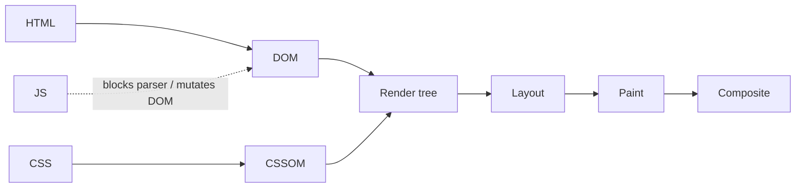

<div align="center">


# ⚡ Topic 1.6 — Web Performance

### Critical rendering path · Caching layers (browser / CDN) · Core Web Vitals · Lighthouse

### Assignment 1.6: optimise `frontend-lab` (lazy loading, image sizing, caching headers) and report before/after Lighthouse scores


</div>

---

## 📑 Contents

| Part | Topic |
|------|-------|
| [0](#0-concepts-read-first) | Critical render path, Core Web Vitals, caching layers |
| [A](#part-a-baseline-lighthouse) | Baseline Lighthouse run |
| [B](#part-b-optimise-the-spa) | Images, fonts, lazy loading, preconnect |
| [C](#part-c-caching-headers--local-preview-server) | `Cache-Control` rules + preview with headers |
| [D](#part-d-after-scores--report) | After scores + `PERFORMANCE.md` |
| [📤](#-what-to-submit) | Submission and marking |

> Continue in `frontend-lab` after 1.5. Always measure a **production build** (`npm run build && npm run preview`), never the dev server.
>
> ```bash
> git checkout -b assignment-1.6
> ```

---

## 0. Concepts (read first)

### Critical rendering path
How bytes become pixels:



- **CSS is render-blocking**; **sync JS is parser-blocking** (`defer` / `type="module"` fixes this)  
- Keep the critical path short: fewer, smaller, earlier resources  
- SPAs add a cost: HTML is empty until JS downloads, parses and executes (why code splitting from 1.5 matters)

### Core Web Vitals

| Metric | Measures | Good | Typical fixes |
|--------|----------|------|----------------|
| **LCP** Largest Contentful Paint | Loading | ≤ 2.5 s | Optimise hero image, preload, less JS |
| **INP** Interaction to Next Paint | Responsiveness | ≤ 200 ms | Break up long tasks, less main-thread JS |
| **CLS** Cumulative Layout Shift | Visual stability | ≤ 0.1 | `width`/`height` on images, reserve space |

Other Lighthouse numbers: FCP, TBT (lab proxy for INP), Speed Index.

### Caching layers

```text
Browser memory/disk cache → Service Worker (4.5) → CDN edge → Reverse proxy → Origin server
```

| Layer | Controlled by | Notes |
|-------|---------------|-------|
| **Browser** | `Cache-Control`, `ETag`, `Last-Modified` | Fastest: zero network |
| **CDN** | `Cache-Control: s-maxage`, purge | Serves from a location near users |
| **Origin** | App/Nginx caching, Redis (3.4) | Protects the database |

Rule for SPAs built with hashed filenames:

| Resource | Header | Why |
|----------|--------|-----|
| `/assets/*-<hash>.js\|css\|woff2` | `public, max-age=31536000, immutable` | Content changes ⇒ filename changes |
| `index.html` | `no-cache` (revalidate every time) | Must point to the newest hashes |
| API JSON | `no-store` or short `max-age` + `ETag` | Data freshness / privacy |

`no-cache` does **not** mean "don't cache"; it means "cache, but revalidate". `no-store` means never store.

### Lighthouse basics
Chrome DevTools → **Lighthouse** (or `npx lighthouse`). Categories: Performance, Accessibility, Best Practices, SEO. Run in **Incognito**, mobile mode, 3 runs, and take the median; scores vary ±5.

---

## Part A: Baseline Lighthouse

```bash
npm run build && npm run preview
npx lighthouse http://localhost:4173 --preset=perf --output=html --output-path=./lighthouse/before.html --chrome-flags="--headless"
```

Or use the DevTools Lighthouse tab (Mobile, Performance + Accessibility + Best Practices + SEO). Record in `PERFORMANCE.md`: Performance score, FCP, LCP, TBT, CLS, total transferred kB. Save `lighthouse/before.html` (or screenshots).

> To make the lab interesting, first add one heavy image to Home (e.g. a 2000px Unsplash photo) so there's something to fix.

---

## Part B: Optimise the SPA

Work through this checklist; keep a log of each change and the measured effect.

**1. Images**: right size, modern format, no layout shift, lazy below the fold:

```jsx
{/* Hero (above the fold): eager + high priority, explicit size */}


{/* Below the fold: lazy + async decode */}

```

**2. Fonts**: self-host or use `preconnect` + `display=swap`:

```html
<link rel="preconnect" href="https://fonts.googleapis.com" />
<link rel="preconnect" href="https://fonts.gstatic.com" crossorigin />
```

**3. JS**: confirm route splitting from 1.5; lazy-load anything not needed for first paint; remove unused dependencies (check `stats.html`).

**4. Render**: avoid layout shift: reserve space for the loading spinner / skeleton cards in the Users page (`min-h-*` or skeleton component).

**5. Prefetch/preload** (only what's critical):

```html
<link rel="preload" as="image" href="/hero-800.webp" fetchpriority="high" />
```

**6. Memoise only after profiling**: use React DevTools Profiler to find a slow re-render before adding `memo` / `useMemo`.

---

## Part C: Caching headers + local preview server

Vite's `preview` doesn't send production cache headers, so add them in config to simulate a host (you can also use a tiny Express server from Unit 2):

`vite.config.js` (add):

```js
preview: {
  headers: { 'Cache-Control': 'no-cache' }, // default: HTML revalidates
},
```

For finer control use a small static server `serve.js`:

```js
import express from 'express';
import path from 'node:path';

const app = express();
const dist = path.resolve('dist');

app.use('/assets', express.static(path.join(dist, 'assets'), {
  immutable: true, maxAge: '1y',               // hashed files
}));
app.use(express.static(dist, {
  setHeaders: (res, file) => { if (file.endsWith('.html')) res.setHeader('Cache-Control', 'no-cache'); },
}));
app.get('/{*splat}', (_req, res) => {            // SPA fallback (Express 5 syntax)
  res.setHeader('Cache-Control', 'no-cache');
  res.sendFile(path.join(dist, 'index.html'));
});
app.listen(4000, () => console.log('http://localhost:4000'));
```

Verify with:

```bash
curl -I http://localhost:4000/                         # Cache-Control: no-cache
curl -I http://localhost:4000/assets/<some-hash>.js    # public, max-age=31536000, immutable
```

Reload with DevTools open: hashed assets should show **(disk cache)** / `0 ms`.

In `PERFORMANCE.md`, write a **header table** for a real deployment: for Nginx/CDN (e.g. Cloudflare, CloudFront), list headers for HTML, hashed assets, images, API, plus how you would purge the CDN on deploy. Notes only; no CDN account needed. Compare with the service-worker strategies from 4.5.

---

## Part D: After scores & report

Re-run Lighthouse with the same settings (3 runs, median). `PERFORMANCE.md` template:

| Metric | Before | After | Δ |
|--------|:------:|:-----:|:-:|
| Performance score | | | |
| FCP | | | |
| LCP | | | |
| TBT | | | |
| CLS | | | |
| JS transferred (kB) | | | |
| Image transferred (kB) | | | |

Include: the change log (what/why/effect), your header table, remaining Lighthouse opportunities you chose **not** to fix and why, and links/screenshots of `lighthouse/before.html` and `after.html`. Target: Performance ≥ 90 (mobile) or a clearly explained gap.

---

## 📤 What to submit

1. Repo/PR with optimisations, `serve.js` (or headers config), `PERFORMANCE.md`, `lighthouse/` reports  
2. Screenshots: Lighthouse before and after; Network panel showing cached hashed assets  
3. Short answers: what blocks rendering; `no-cache` vs `no-store`; why hashed filenames pair with `immutable`; CLS cause and fix  

## 🧮 Marking (10)

| Criteria | Marks |
|----------|:-----:|
| Baseline + after Lighthouse reports (same method) | 2 |
| Image optimisation (size, format, lazy/priority, dimensions) | 2 |
| Other optimisations with change log and measured effect | 2 |
| Caching headers implemented/verified (`curl -I`) + deployment header notes | 3 |
| Short answers | 1 |

### ⭐ Bonus (+2)
Add the [`web-vitals`](https://www.npmjs.com/package/web-vitals) library and log LCP/INP/CLS from real browsing to the console (or POST to `users-api` in Unit 2).

---

<div align="center">

⬅️ [Topic 1.5](../1.5%20Build%20Tools/README.md)  ·  **Topic 1.6**  ·  🎓 End of Unit 1 · Continue to [Unit 2: Backend Engineering](<../../Unit 2 - Backend Engineering & Secure API Design (14 Hours)>)

</div>
