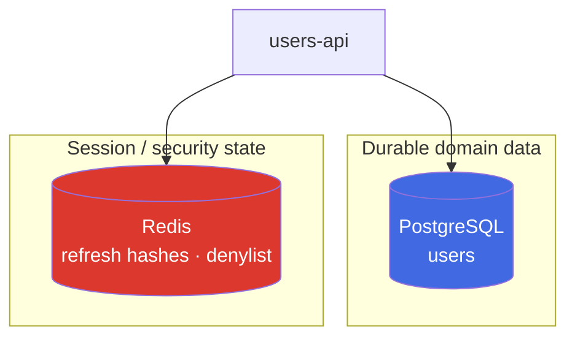

<div align="center">


# ⚡ Topic 3.2 — NoSQL Databases

### Redis · Key-value · Document stores · SQL vs NoSQL · Token storage · Logout

### Assignment 3.2: store refresh tokens in Redis (`redis.js`) and make logout revoke them for real


</div>

---

## 📑 Contents

| Part | Topic |
|------|-------|
| [0](#0-concepts-read-first) | **Concepts:** SQL vs NoSQL, Redis vs MongoDB, when to use each |
| [A](#part-a-redisjs--connection) | **`src/redis.js`:** connect to the Redis container from 3.1 |
| [B](#part-b-refresh-tokens-in-redis) | **Tokens:** Redis-backed refresh-token store |
| [C](#part-c-logout--access-token-denylist) | **Logout:** revoke refresh family + denylist access JWT |
| [D](#part-d-wire-up--try-it) | **Wire-up** and curl proof that logout works across restarts |
| [E](#part-e-tests) | **Tests** |
| [📤](#-what-to-submit) | Submission and marking |

> 📌 **Before you start:** Assignment 3.1 is merged (`users` in PostgreSQL, Compose running). Then:
>
> ```bash
> cd users-api
> git checkout main && git pull
> git checkout -b assignment-3.2
> npm install ioredis
> ```
>
> Redis is already defined in `docker-compose.yml` from 3.1. Start it if needed: `docker compose up -d`.

---

## 0. Concepts (read first)

### 0.1 SQL vs NoSQL — choose deliberately

| | 🐘 **Relational (PostgreSQL)** | 📄 **Document (MongoDB)** | 🔑 **Key-value (Redis)** |
|---|---|---|---|
| Model | Tables, rows, joins | JSON-like documents in collections | Keys → values (strings, hashes, sets, …) |
| Schema | Declared up front | Flexible per document | Implicit in key design |
| Strength | Consistency, relations, ad-hoc queries | Nested documents, rapid iteration | Speed, TTL, pub/sub, caching |
| Persistence | Durable on disk | Durable on disk | Often in-memory (+ optional AOF/RDB) |
| In `users-api` | **User profiles** (3.1 / 3.3) | Concepts only this term | **Auth tokens / logout** (this topic) |



> 🎯 **Key Concept:** Putting refresh tokens in Postgres works, but Redis is a better fit: every token has a **TTL**, lookups are by exact key, and logout should be **fast and shared** across API instances. User rows stay in PostgreSQL.

### 0.2 Redis data types you will use

| Type | Command examples | Our use |
|------|------------------|---------|
| **String** | `SET key value EX 60` | Store JSON blob for one refresh token; denylist a JWT `jti` |
| **Set** | `SADD`, `SMEMBERS`, `SREM` | All token hashes in a **family**; all hashes for a **user** |
| **TTL** | `EXPIRE`, `SET … EX` | Auto-delete expired tokens — no cron job |

### 0.3 MongoDB (document store) — know the idea

```js
// Conceptual — you are NOT installing MongoDB in this assignment
{
  _id: ObjectId("…"),
  email: "sita@example.com",
  profile: { firstName: "Sita", addresses: [{ city: "Kathmandu" }] },
  roles: ["customer"]
}
```

| Choose MongoDB when… | Prefer PostgreSQL when… |
|----------------------|-------------------------|
| Documents vary a lot; nested arrays are natural | Strong relations, joins, multi-row transactions |
| You mostly fetch whole documents by id | You need rich reporting queries across tables |

### 0.4 Why Unit 2’s in-memory refresh store is not enough

| Problem | In-memory `Map` | Redis |
|---------|-----------------|-------|
| API restart | All sessions logged out / tokens orphaned | Tokens still there (until TTL) |
| Two Node processes behind Nginx | Each has a different Map — refresh fails randomly | Shared store |
| Logout on instance A, refresh on B | B still accepts the cookie | Both see the revocation |

---

## Part A: `redis.js` — connection

### A.1 `src/redis.js` (new)

This is the **only** place that constructs the Redis client. Repositories import `createRedis` (or receive the client via DI).

```js
import Redis from 'ioredis';
import { env } from './config/env.js';

/**
 * Create a Redis client for auth token storage and logout revocation.
 *
 * Key design (Assignment 3.2):
 *   refresh:token:{sha256}     → JSON metadata (TTL = token lifetime)
 *   refresh:family:{familyId}  → SET of token hashes
 *   refresh:user:{userId}      → SET of token hashes
 *   access:deny:{jti}          → "1" (TTL = remaining access-token lifetime)
 */
export function createRedis(url = env.redisUrl) {
  const client = new Redis(url, {
    maxRetriesPerRequest: 3,
    enableReadyCheck: true,
    lazyConnect: false,
  });

  client.on('error', (err) => {
    // Never crash the process on a single command error; log for ops.
    console.error('[redis]', err.message);
  });

  return client;
}

export async function pingRedis(client) {
  const pong = await client.ping();
  if (pong !== 'PONG') throw new Error(`Unexpected Redis PING reply: ${pong}`);
  return pong;
}
```

### A.2 Env (confirm from 3.1)

```env
REDIS_URL=redis://127.0.0.1:6379
```

```js
// env.js — make redis required now that we depend on it in production paths
redisUrl: required('REDIS_URL'),
```

### A.3 Sanity check

```bash
docker compose up -d
node --env-file-if-exists=.env -e "
  import { createRedis, pingRedis } from './src/redis.js';
  const r = createRedis();
  console.log(await pingRedis(r));
  await r.quit();
"
```

Expected: `PONG`.

---

## Part B: Refresh tokens in Redis

### B.1 Same interface, new storage

`TokenService` already calls:

- `create({ userId, tokenHash, familyId, expiresAt, revokedAt, replacedBy })`
- `findByHash(tokenHash)`
- `update(id, changes)`
- `revokeFamily(familyId)`
- `revokeAllForUser(userId)`

Your Redis repository must honour that contract so **`token.service.js` stays unchanged** (or only gains denylist hooks in Part C).

### B.2 `src/repositories/refresh-tokens.repository.js` (replace)

```js
import { randomUUID } from 'node:crypto';

const tokenKey = (hash) => `refresh:token:${hash}`;
const idKey = (id) => `refresh:id:${id}`;
const familyKey = (familyId) => `refresh:family:${familyId}`;
const userKey = (userId) => `refresh:user:${userId}`;

function ttlSeconds(expiresAt) {
  const ms = new Date(expiresAt).getTime() - Date.now();
  return Math.max(1, Math.ceil(ms / 1000));
}

export class RefreshTokensRepository {
  /** @param {import('ioredis').default} redis */
  constructor(redis) {
    this.redis = redis;
  }

  async create(data) {
    const id = randomUUID();
    const row = {
      id,
      userId: data.userId,
      tokenHash: data.tokenHash,
      familyId: data.familyId,
      expiresAt: data.expiresAt,
      revokedAt: data.revokedAt ?? null,
      replacedBy: data.replacedBy ?? null,
      createdAt: new Date().toISOString(),
      updatedAt: new Date().toISOString(),
    };

    const ttl = ttlSeconds(row.expiresAt);
    const pipe = this.redis.pipeline();
    pipe.set(tokenKey(row.tokenHash), JSON.stringify(row), 'EX', ttl);
    pipe.set(idKey(id), row.tokenHash, 'EX', ttl);
    pipe.sadd(familyKey(row.familyId), row.tokenHash);
    pipe.expire(familyKey(row.familyId), ttl);
    pipe.sadd(userKey(row.userId), row.tokenHash);
    pipe.expire(userKey(row.userId), ttl);
    await pipe.exec();
    return row;
  }

  async findByHash(tokenHash) {
    const raw = await this.redis.get(tokenKey(tokenHash));
    return raw ? JSON.parse(raw) : null;
  }

  async update(id, changes) {
    const tokenHash = await this.redis.get(idKey(id));
    if (!tokenHash) return null;
    const current = await this.findByHash(tokenHash);
    if (!current) return null;

    const row = { ...current, ...changes, updatedAt: new Date().toISOString() };
    const ttl = ttlSeconds(row.expiresAt);
    await this.redis.set(tokenKey(row.tokenHash), JSON.stringify(row), 'EX', ttl);
    return row;
  }

  async revokeWhere(hashes) {
    const now = new Date().toISOString();
    for (const tokenHash of hashes) {
      const row = await this.findByHash(tokenHash);
      if (!row || row.revokedAt) continue;
      row.revokedAt = now;
      row.updatedAt = now;
      const ttl = await this.redis.ttl(tokenKey(tokenHash));
      if (ttl > 0) {
        await this.redis.set(tokenKey(tokenHash), JSON.stringify(row), 'EX', ttl);
      }
    }
  }

  async revokeFamily(familyId) {
    const hashes = await this.redis.smembers(familyKey(familyId));
    await this.revokeWhere(hashes);
  }

  async revokeAllForUser(userId) {
    const hashes = await this.redis.smembers(userKey(userId));
    await this.revokeWhere(hashes);
  }
}
```

> ⚠️ **Security:** Store only the **SHA-256 hash** of the refresh token (Unit 2 rule). Redis holds metadata, never the raw cookie value.

---

## Part C: Logout & access-token denylist

### C.1 Refresh logout (already in TokenService)

`POST /auth/logout` already calls `revokeRefreshToken` → `revokeFamily`. With Redis, that revocation **survives restarts** and is visible to every API instance.

### C.2 Why denylist access tokens?

Access JWTs are **stateless** for 15 minutes. After logout, a stolen Bearer token would still work until expiry unless we check a denylist.

On logout (and password change), store the access token’s `jti` (JWT ID) in Redis with TTL = remaining lifetime. `authenticate` middleware rejects denylisted tokens.

### C.3 Add `jti` when signing

In `token.service.js` → `signAccessToken`:

```js
signAccessToken(user) {
  return jwt.sign({ role: user.role }, this.secret, {
    ...this.jwtOptions,
    subject: user.id,
    jwtid: randomUUID(), // → payload.jti
    algorithm: 'HS256',
    expiresIn: this.accessTokenTtlSeconds,
  });
}
```

`verifyAccessToken` should return `{ id, role, jti, exp }`:

```js
verifyAccessToken(token) {
  try {
    const payload = jwt.verify(token, this.secret, {
      ...this.jwtOptions,
      algorithms: ['HS256'],
    });
    return {
      id: payload.sub,
      role: payload.role,
      jti: payload.jti,
      exp: payload.exp,
    };
  } catch (err) {
    throw unauthorized(
      err.name === 'TokenExpiredError' ? 'Access token expired' : 'Invalid access token',
    );
  }
}
```

### C.4 Denylist helpers on `TokenService` (or a tiny collaborator)

```js
denyKey(jti) {
  return `access:deny:${jti}`;
}

async denylistAccessToken(accessToken) {
  if (!accessToken) return;
  let payload;
  try {
    payload = jwt.verify(accessToken, this.secret, {
      ...this.jwtOptions,
      algorithms: ['HS256'],
      ignoreExpiration: false,
    });
  } catch {
    return; // already invalid/expired — nothing to denylist
  }
  if (!payload.jti || !payload.exp) return;
  const ttl = Math.max(1, payload.exp - Math.floor(Date.now() / 1000));
  await this.redis.set(this.denyKey(payload.jti), '1', 'EX', ttl);
}

async isAccessTokenDenied(jti) {
  if (!jti) return false;
  return (await this.redis.exists(this.denyKey(jti))) === 1;
}
```

Inject `redis` into `TokenService` (constructor) alongside the refresh repository.

### C.5 `authenticate` middleware

```js
const user = tokens.verifyAccessToken(bearer);
if (await tokens.isAccessTokenDenied(user.jti)) {
  throw unauthorized('Access token revoked');
}
req.user = { id: user.id, role: user.role };
```

### C.6 Auth logout flow

In `AuthService.logout` / controller — pass **both** the refresh cookie and the Bearer access token:

```js
async logout({ refreshToken, accessToken }) {
  await this.tokens.revokeRefreshToken(refreshToken);
  await this.tokens.denylistAccessToken(accessToken);
}
```

Controller reads `Authorization` header when present.

---

## Part D: Wire-up & try it

### D.1 `container.js`

```js
import { createRedis } from './redis.js';
import { RefreshTokensRepository } from './repositories/refresh-tokens.repository.js';

export function createContainer(overrides = {}) {
  const pool = overrides.pool ?? createPool();
  const redis = overrides.redis ?? createRedis();

  const usersRepository = overrides.usersRepository ?? new UsersRepository(pool);
  const refreshTokensRepository =
    overrides.refreshTokensRepository ?? new RefreshTokensRepository(redis);

  const tokenService =
    overrides.tokenService ??
    new TokenService(refreshTokensRepository, redis, { /* jwt env… */ });

  // …
  return { pool, redis, usersRepository, refreshTokensRepository, tokenService, /* … */ };
}
```

### D.2 Shutdown

```js
async function shutdown() {
  server.close();
  await container.pool.end();
  await container.redis.quit();
  process.exit(0);
}
```

### D.3 Curl proof

```bash
docker compose up -d
npm run dev

# Login
curl -s -c cookies.txt -X POST http://127.0.0.1:3000/api/v1/auth/login \
  -H 'content-type: application/json' \
  -d '{"email":"sita@example.com","password":"Secret123!"}' | tee login.json | jq

ACCESS=$(jq -r .accessToken login.json)

# Access works
curl -s http://127.0.0.1:3000/api/v1/users/me \
  -H "authorization: Bearer $ACCESS" | jq

# Logout (send Bearer + cookie)
curl -s -b cookies.txt -X POST http://127.0.0.1:3000/api/v1/auth/logout \
  -H "authorization: Bearer $ACCESS" -i

# Refresh must fail
curl -s -b cookies.txt -X POST http://127.0.0.1:3000/api/v1/auth/refresh -i

# Access must fail (denylist) even before JWT exp
curl -s http://127.0.0.1:3000/api/v1/users/me \
  -H "authorization: Bearer $ACCESS" -i
```

Inspect Redis:

```bash
docker compose exec redis redis-cli KEYS 'refresh:*'
docker compose exec redis redis-cli KEYS 'access:deny:*'
```

Restart the API and confirm a **new** login’s refresh still works, and an old denylisted access token still fails until TTL.

```bash
git add .
git commit -m "feat(auth): store refresh tokens in Redis and denylist access JWTs on logout"
git push -u origin assignment-3.2
```

Merge after submitting.

---

## Part E: Tests

1. **Unit:** fake Redis (in-memory map implementing `get`/`set`/`sadd`/`smembers`/`ttl`/`exists`/`pipeline`) or `ioredis-mock`.
2. **Integration:** real Redis from Compose.
   - login → logout → refresh 401
   - login → logout → Bearer 401 (denylist)
   - reuse detection still revokes family

```bash
npm test
```

---

## 📤 What to submit

1. **Pull Request** (`assignment-3.2` → `main`).
2. **Screenshots:**
   - `src/redis.js` in the PR diff
   - logout curl: refresh 401 + access 401 afterwards
   - `redis-cli KEYS 'refresh:*'` and `KEYS 'access:deny:*'` after login / after logout
3. **Short answers** (3–5 sentences each):
   1. Why keep **users** in PostgreSQL but **refresh tokens** in Redis?
   2. What does a TTL give you that a database row + cron job would also need to solve?
   3. When would you pick MongoDB over PostgreSQL for a new feature in this API?

## 🧮 Marking (10 marks)

| Criteria | Marks |
|----------|:-----:|
| `src/redis.js` connection module; Compose Redis healthy | 2 |
| Refresh tokens in Redis with family/user sets + TTL; hash-only storage | 3 |
| Logout revokes refresh family; access denylist via `jti` | 3 |
| Tests / curl proof; short answers | 2 |

### ⭐ Bonus (+2)

Use Redis to back **rate limiting** (`rate-limit-redis`) so two API processes share the same login attempt counters (ties to Topic 2.5 bonus).

---

<div align="center">

⬅️ [Topic 3.1: Relational Databases](../3.1%20Relational%20Databases%20-%20SQL/README.md)  ·  **Topic 3.2**  ·  [Topic 3.3: ORMs & Query Builders ➡️](../3.3%20ORMs%20and%20Query%20Builders/README.md)

</div>
