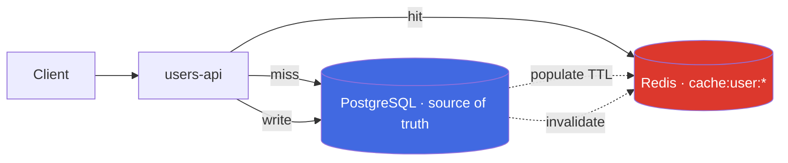

<div align="center">


# 🌐 Topic 3.4 — Distributed Data

### CAP theorem · Redis caching · Cache invalidation · CQRS · Event sourcing fundamentals

### Assignment 3.4: add a Redis read-cache and a simple CQRS write/read split to `users-api`


</div>

---

## 📑 Contents

| Part | Topic |
|------|-------|
| [0](#0-concepts-read-first) | **Concepts:** CAP, caching patterns, CQRS, event sourcing |
| [A](#part-a-redis-user-cache) | **Cache:** `GET /users/:id` via Redis with TTL + invalidation |
| [B](#part-b-cqrs-light) | **CQRS-light:** separate query service + domain events table |
| [C](#part-c-wire-up--try-it) | **Wire-up** and curl proof (cache hit / miss / invalidate) |
| [D](#part-d-tests) | **Tests** |
| [📤](#-what-to-submit) | Submission and marking |

> 📌 **Before you start:** Assignments 3.1–3.3 are merged (Postgres users via Prisma, Redis tokens via `redis.js`). Then:
>
> ```bash
> cd users-api
> git checkout main && git pull
> git checkout -b assignment-3.4
> mkdir -p src/cache src/cqrs src/events
> ```

You already run **Redis** for auth tokens (3.2). This topic reuses the same `src/redis.js` client for a **second keyspace**: user profile cache. Do not mix token keys (`refresh:*`, `access:deny:*`) with cache keys (`cache:user:*`).

---

## 0. Concepts (read first)

### 0.1 CAP theorem

In a distributed system you cannot simultaneously guarantee all three:

| Letter | Meaning | If you weaken it… |
|--------|---------|-------------------|
| **C** Consistency | Every read sees the latest write | Stale reads / eventual consistency |
| **A** Availability | Every request gets a non-error response | Timeouts / 503 when a replica is down |
| **P** Partition tolerance | System keeps working despite network splits | Single-node only (not realistic on the internet) |

On a real network you **must** tolerate partitions (**P**). So the practical choice is **CP** vs **AP**:

| System | Typical trade-off | Example in this course |
|--------|-------------------|------------------------|
| PostgreSQL (primary) | Prefer **C** | User rows must be correct |
| Redis cache | Prefer **A** + speed; accept brief staleness | Cached `GET /users/:id` |
| Redis tokens | Prefer **C** for revoke (or short TTL) | Logout must stick |

> 🎯 **Key Concept:** A cache is an **AP-leaning** optimisation in front of a **CP-leaning** database. You are explicitly choosing “sometimes slightly stale, always fast” for reads.



### 0.2 Caching strategies (Redis)

| Strategy | Behaviour | Use when |
|----------|-----------|----------|
| **Cache-aside** (lazy) | App reads cache → on miss load DB → set cache | Most REST reads (what we build) |
| **Read-through** | Cache library loads DB for you | When you want that logic out of app code |
| **Write-through** | Write cache and DB together | Stronger cache freshness, slower writes |
| **Write-behind** | Write cache first, flush DB async | High write throughput (harder to get right) |

**Invalidation** matters more than clever TTLs:

| Event | Action |
|-------|--------|
| `PATCH /users/:id` | `DEL cache:user:{id}` |
| `DELETE /users/:id` | `DEL cache:user:{id}` |
| Role / password change | Invalidate that user (and maybe list caches) |
| TTL expiry | Safety net if you forgot to invalidate |

### 0.3 CQRS (Command Query Responsibility Segregation)

**Commands** change state. **Queries** only read.

| | Command (write) | Query (read) |
|---|-----------------|--------------|
| Examples | register, update profile, change role | getById, list, search |
| Model | Validated, transactional, emits events | Optimised for reads (cache, projections) |
| Failure | 4xx/409 business rules | 404 / empty page |

Full CQRS often means **separate databases** for reads and writes. In this assignment you practise a **CQRS-light** shape inside one API:

1. `UsersCommandService` — writes via Prisma, appends domain events  
2. `UsersQueryService` — reads via cache-aside Redis + Prisma  
3. Controllers call the right side

### 0.4 Event sourcing — fundamentals (not full rewrite)

**Event sourcing** stores every change as an append-only event (`UserRegistered`, `UserUpdated`, …). The current state is a fold over events.

You will **not** rebuild the whole app as event-sourced. You will:

- Keep Prisma `User` as the current state (state store)
- Append rows to an `domain_events` table on each successful command (audit + future projections)

That is the industry “events alongside state” stepping stone toward full event sourcing / CQRS.

---

## Part A: Redis user cache

### A.1 Key design

```text
cache:user:{uuid}  → JSON public user   EX 60   (or CACHE_USER_TTL_SECONDS)
```

Never cache `passwordHash`. Cache only what `toPublicUser` returns.

### A.2 `src/cache/user-cache.js` (new)

```js
const key = (id) => `cache:user:${id}`;

export class UserCache {
  /** @param {import('ioredis').default} redis */
  constructor(redis, { ttlSeconds = 60 } = {}) {
    this.redis = redis;
    this.ttlSeconds = ttlSeconds;
  }

  async get(id) {
    const raw = await this.redis.get(key(id));
    return raw ? JSON.parse(raw) : null;
  }

  async set(user) {
    if (!user?.id) return;
    await this.redis.set(key(user.id), JSON.stringify(user), 'EX', this.ttlSeconds);
  }

  async invalidate(id) {
    await this.redis.del(key(id));
  }
}
```

### A.3 Env

```env
CACHE_USER_TTL_SECONDS=60
```

```js
// env.js
cacheUserTtlSeconds: toInt(process.env.CACHE_USER_TTL_SECONDS, 60),
```

### A.4 Query path uses the cache

```js
// src/cqrs/users-query.service.js
export class UsersQueryService {
  constructor(usersRepository, userCache) {
    this.users = usersRepository;
    this.cache = userCache;
  }

  async getById(id) {
    const cached = await this.cache.get(id);
    if (cached) {
      cached._cache = 'HIT'; // only for learning / response header — strip in production if you prefer
      return cached;
    }
    const user = await this.users.findById(id);
    if (!user) return null;
    const publicUser = stripHash(user); // same as toPublicUser
    await this.cache.set(publicUser);
    return { ...publicUser, _cache: 'MISS' };
  }

  async list(query) {
    // Optional: skip caching lists in this assignment (harder invalidation).
    return this.users.findAll(/* filters in service as before */);
  }
}
```

In the controller, expose the cache outcome as a header (clearer than polluting JSON):

```js
res.setHeader('X-Cache', user._cache ?? 'MISS');
const { _cache, ...body } = user;
res.json({ data: body });
```

---

## Part B: CQRS-light + domain events

### B.1 Prisma model for events

Add to `prisma/schema.prisma`:

```prisma
model DomainEvent {
  id          String   @id @default(uuid()) @db.Uuid
  type        String
  aggregateId String   @map("aggregate_id") @db.Uuid
  payload     Json
  createdAt   DateTime @default(now()) @map("created_at")

  @@index([aggregateId, createdAt])
  @@index([type, createdAt])
  @@map("domain_events")
}
```

```bash
npx prisma migrate dev --name add_domain_events
```

### B.2 `src/events/event-store.js`

```js
export class EventStore {
  constructor(prisma) {
    this.prisma = prisma;
  }

  append({ type, aggregateId, payload }) {
    return this.prisma.domainEvent.create({
      data: { type, aggregateId, payload },
    });
  }

  listForAggregate(aggregateId, { take = 50 } = {}) {
    return this.prisma.domainEvent.findMany({
      where: { aggregateId },
      orderBy: { createdAt: 'asc' },
      take,
    });
  }
}
```

### B.3 `src/cqrs/users-command.service.js`

Commands write Postgres, append an event, **then** invalidate the cache:

```js
export class UsersCommandService {
  constructor(usersRepository, eventStore, userCache, usersServiceDeps) {
    // Reuse hashing / validation from your existing UsersService, or wrap it.
    this.users = usersRepository;
    this.events = eventStore;
    this.cache = userCache;
    // ...
  }

  async update(id, changes) {
    const user = await this.users.update(id, changes); // existing rules
    await this.events.append({
      type: 'UserUpdated',
      aggregateId: id,
      payload: { changes: Object.keys(changes) },
    });
    await this.cache.invalidate(id);
    return stripHash(user);
  }

  async remove(id) {
    await this.users.delete(id);
    await this.events.append({
      type: 'UserDeleted',
      aggregateId: id,
      payload: {},
    });
    await this.cache.invalidate(id);
  }

  // create / changeRole / changePassword follow the same pattern
}
```

> ⚠️ Order: **persist → append event → invalidate cache**. If you invalidate before a failed write, you create unnecessary misses; if you forget invalidate, readers see stale data until TTL.

### B.4 Optional read API for events (learning)

```http
GET /api/v1/users/:id/events
Authorization: Bearer …   (admin or self)
```

Returns the append-only history from `domain_events`. This is **not** public product UI — it proves CQRS/event ideas.

### B.5 Container wiring

```js
const userCache = new UserCache(redis, { ttlSeconds: env.cacheUserTtlSeconds });
const eventStore = new EventStore(prisma);
const usersQueryService = new UsersQueryService(usersRepository, userCache);
const usersCommandService = new UsersCommandService(usersRepository, eventStore, userCache, …);

// Controllers:
//   GET/LIST → usersQueryService
//   POST/PATCH/DELETE → usersCommandService
```

Auth token Redis usage from 3.2 stays untouched.

---

## Part C: Wire-up & try it

```bash
docker compose up -d
npx prisma migrate deploy
npm run dev
```

```bash
# Login, capture access token
ACCESS=…

# 1) Miss — loads Postgres, fills Redis
curl -si http://127.0.0.1:3000/api/v1/users/$USER_ID \
  -H "authorization: Bearer $ACCESS" | grep -i x-cache
# X-Cache: MISS

# 2) Hit — served from Redis
curl -si http://127.0.0.1:3000/api/v1/users/$USER_ID \
  -H "authorization: Bearer $ACCESS" | grep -i x-cache
# X-Cache: HIT

# 3) Update → invalidates
curl -s -X PATCH http://127.0.0.1:3000/api/v1/users/$USER_ID \
  -H "authorization: Bearer $ACCESS" \
  -H 'content-type: application/json' \
  -d '{"firstName":"Sita"}'

# 4) Next GET is MISS again, then HIT
curl -si http://127.0.0.1:3000/api/v1/users/$USER_ID \
  -H "authorization: Bearer $ACCESS" | grep -i x-cache

# 5) Events recorded
curl -s http://127.0.0.1:3000/api/v1/users/$USER_ID/events \
  -H "authorization: Bearer $ACCESS" | jq

# 6) Inspect Redis
docker compose exec redis redis-cli KEYS 'cache:user:*'
docker compose exec redis redis-cli GET cache:user:$USER_ID
```

```bash
git add .
git commit -m "feat(cache): Redis user cache-aside + CQRS-light domain events"
git push -u origin assignment-3.4
```

Merge after submitting.

---

## Part D: Tests

| Case | Expect |
|------|--------|
| `getById` twice | first MISS, second HIT (fake or real Redis) |
| `update` then `getById` | MISS (invalidated) |
| command creates `DomainEvent` row | type `UserUpdated` |
| token keys unaffected | `refresh:*` still works for login/logout |

```bash
npm test
```

---

## 📤 What to submit

1. **Pull Request** (`assignment-3.4` → `main`).
2. **Screenshots:**
   - `X-Cache: MISS` then `X-Cache: HIT` on the same user
   - After PATCH, MISS again
   - `redis-cli KEYS 'cache:user:*'`
   - `GET /users/:id/events` JSON
3. **Short answers** (3–5 sentences each):
   1. In CAP terms, what does your Redis user cache trade away, and why is that acceptable for `GET /users/:id`?
   2. Why is cache-aside + explicit invalidation safer than “only TTL” for profile updates?
   3. How is your CQRS-light design different from full event sourcing? When would you go further?

## 🧮 Marking (10 marks)

| Criteria | Marks |
|----------|:-----:|
| Clear CAP / caching / CQRS concepts reflected in code structure | 2 |
| Redis cache-aside with TTL + invalidation on write | 3 |
| Command/query split + `domain_events` append on commands | 3 |
| Curl/tests proof; short answers | 2 |

### ⭐ Bonus (+2)

Cache the **paginated list** under `cache:users:list:{hash(query)}` with a short TTL (10s) **or** a version key `cache:users:ver` that you bump on every write (show both ideas in a short comment).

---

<div align="center">

⬅️ [Topic 3.3: ORMs](../3.3%20ORMs%20and%20Query%20Builders/README.md)  ·  **Topic 3.4**  ·  [Topic 3.5: API Architectures ➡️](../3.5%20API%20Architectures/README.md)

</div>
