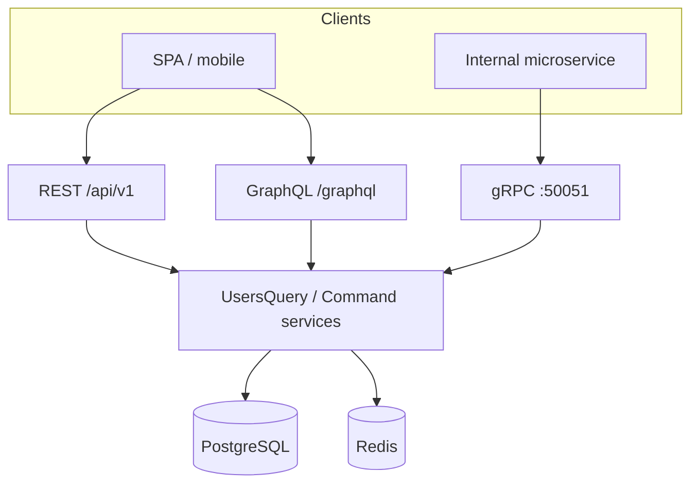

<div align="center">


# 📡 Topic 3.5 — API Architectures

### REST · GraphQL · gRPC · OpenAPI / Swagger · Choosing the right style

### Assignment 3.5: document `users-api` with OpenAPI and add a GraphQL query surface (gRPC as a lab sidecar)


</div>

---

## 📑 Contents

| Part | Topic |
|------|-------|
| [0](#0-concepts-read-first) | **Concepts:** REST vs GraphQL vs gRPC; when to use each |
| [A](#part-a-openapi--swagger-ui) | **OpenAPI:** describe your REST API and serve Swagger UI |
| [B](#part-b-graphql) | **GraphQL:** `user` + `users` queries over the same services |
| [C](#part-c-grpc-sidecar-lab) | **gRPC:** minimal Node sidecar + `.proto` (concepts → hands-on) |
| [D](#part-d-try-it) | **Try it** end to end |
| [E](#part-e-tests) | **Tests** |
| [📤](#-what-to-submit) | Submission and marking |

> 📌 **Before you start:** Assignment 3.4 is merged (or at least 3.3 + Redis). Then:
>
> ```bash
> cd users-api
> git checkout main && git pull
> git checkout -b assignment-3.5
> npm install swagger-ui-express yaml graphql graphql-http @grpc/grpc-js @grpc/proto-loader
> # optional helper for OpenAPI from JS:
> npm install -D @asteasolutions/zod-to-openapi   # only if you generate from Zod
> mkdir -p openapi src/graphql proto src/grpc
> ```

Your **HTTP REST** API remains the primary interface. GraphQL and gRPC sit beside it and call the **same** query/command services — no duplicated business rules.

---

## 0. Concepts (read first)

### 0.1 Three styles, one product

| | **REST** (what you have) | **GraphQL** | **gRPC** |
|---|---|---|---|
| Contract | URLs + HTTP verbs + JSON | Schema (types + queries/mutations) | `.proto` + HTTP/2 + Protobuf |
| Payload shape | Server decides (DTOs) | Client asks for fields | Fixed message fields |
| Versioning | `/api/v1` … | Evolve schema carefully | Package / service version |
| Best for | Public HTTP APIs, CRUD, caches, browsers | Flexible clients, BFF, nested reads | Internal service-to-service, low latency |
| Browser | Native | HTTP POST / playground | Needs grpc-web or a gateway |



### 0.2 OpenAPI / Swagger

**OpenAPI** is the machine-readable contract for your REST API. **Swagger UI** renders it as interactive docs.

Students and frontend teammates stop guessing status codes and body shapes. Tools generate clients from the same file.

### 0.3 GraphQL in one minute

```graphql
query {
  user(id: "…") { id email role }
  users(limit: 5) { id firstName }
}
```

One endpoint, client-selected fields. You still enforce **authZ** in resolvers (same `authenticate` / RBAC ideas as REST).

### 0.4 gRPC in one minute

```protobuf
service Users {
  rpc GetUser (GetUserRequest) returns (User);
}
```

Binary Protobuf over HTTP/2. Excellent between services; awkward in browsers without extra work. You will run a **small sidecar** so you touch real stubs without rewriting Express.

---

## Part A: OpenAPI + Swagger UI

### A.1 `openapi/openapi.yaml` (start here — hand-written is fine)

```yaml
openapi: 3.1.0
info:
  title: users-api
  version: 1.0.0
  description: ITEX 320 users-api (Unit 2 + Unit 3)
servers:
  - url: http://127.0.0.1:3000
    description: Local
paths:
  /api/v1/users/{id}:
    get:
      summary: Get user by id
      tags: [Users]
      parameters:
        - name: id
          in: path
          required: true
          schema: { type: string, format: uuid }
      security:
        - bearerAuth: []
      responses:
        "200":
          description: Public user
          headers:
            X-Cache:
              schema: { type: string, enum: [HIT, MISS] }
          content:
            application/json:
              schema:
                type: object
                properties:
                  data: { $ref: "#/components/schemas/PublicUser" }
        "401": { description: Unauthorized }
        "404": { description: Not found }
  /api/v1/auth/login:
    post:
      summary: Login
      tags: [Auth]
      requestBody:
        required: true
        content:
          application/json:
            schema:
              type: object
              required: [email, password]
              properties:
                email: { type: string, format: email }
                password: { type: string }
      responses:
        "200":
          description: Access token (+ refresh cookie)
components:
  securitySchemes:
    bearerAuth:
      type: http
      scheme: bearer
      bearerFormat: JWT
  schemas:
    PublicUser:
      type: object
      properties:
        id: { type: string, format: uuid }
        firstName: { type: string }
        lastName: { type: string }
        email: { type: string, format: email }
        role: { type: string, enum: [customer, admin] }
```

Expand the file to cover **at least**: register, login, refresh, logout, list users, get user, patch user, delete user. Matching your real routes from Unit 2–3.

### A.2 Serve Swagger UI

```js
// src/docs/openapi.js
import { readFileSync } from 'node:fs';
import path from 'node:path';
import { fileURLToPath } from 'node:url';
import YAML from 'yaml';
import swaggerUi from 'swagger-ui-express';

const __dirname = path.dirname(fileURLToPath(import.meta.url));
const spec = YAML.parse(
  readFileSync(path.resolve(__dirname, '../../openapi/openapi.yaml'), 'utf8'),
);

export function mountDocs(app) {
  app.get('/openapi.json', (_req, res) => res.json(spec));
  app.use('/docs', swaggerUi.serve, swaggerUi.setup(spec, { explorer: true }));
}
```

In `app.js` (before auth-gated API is fine — docs are public in class; lock them down later if needed):

```js
import { mountDocs } from './docs/openapi.js';
mountDocs(app);
```

Open [http://127.0.0.1:3000/docs](http://127.0.0.1:3000/docs) and [http://127.0.0.1:3000/openapi.json](http://127.0.0.1:3000/openapi.json).

> 🎯 **Key Concept:** The YAML is the **contract**. If the code changes a status code, update OpenAPI in the same PR.

---

## Part B: GraphQL

### B.1 Schema

```js
// src/graphql/schema.js
export const typeDefs = /* GraphQL */ `
  type User {
    id: ID!
    firstName: String!
    lastName: String!
    email: String!
    role: String!
  }

  type Query {
    user(id: ID!): User
    users(limit: Int = 20): [User!]!
  }
`;
```

### B.2 Resolvers → existing query service

```js
// src/graphql/resolvers.js
export function createResolvers({ usersQueryService }) {
  return {
    Query: {
      user: async (_parent, { id }, ctx) => {
        requireAuth(ctx); // read Authorization from ctx
        const user = await usersQueryService.getById(id);
        if (!user) return null;
        const { _cache, passwordHash, ...publicUser } = user;
        return publicUser;
      },
      users: async (_parent, { limit }, ctx) => {
        requireAuth(ctx);
        const page = await usersQueryService.list({ limit });
        return page.data ?? page;
      },
    },
  };
}

function requireAuth(ctx) {
  if (!ctx.user) {
    const err = new Error('Unauthorized');
    err.statusCode = 401;
    throw err;
  }
}
```

### B.3 Mount with `graphql-http`

```js
// src/graphql/mount.js
import { createHandler } from 'graphql-http/lib/use/express';
import { buildSchema } from 'graphql';
// Or use GraphQLSchema from graphql + makeExecutableSchema if you prefer graphql-tools.

export function mountGraphql(app, { schema, contextFromReq }) {
  app.all(
    '/graphql',
    createHandler({
      schema,
      context: (req) => contextFromReq(req.raw),
    }),
  );
}
```

Simpler path many students use — `graphql` + `graphql-http` with a schema built from `typeDefs` via `graphql-tools` **or** a handwritten `GraphQLSchema`. Pick one and stick to it.

Minimal **context** extracts the Bearer token the same way REST `authenticate` does, then sets `ctx.user`.

### B.4 Try a query

```bash
curl -s http://127.0.0.1:3000/graphql \
  -H "authorization: Bearer $ACCESS" \
  -H 'content-type: application/json' \
  -d '{"query":"{ user(id:\"'"$USER_ID"'\") { id email role } }"}' | jq
```

---

## Part C: gRPC sidecar lab

Keep Express as-is. Add a **second process** that speaks gRPC and calls the same Prisma/query layer (or HTTP-calls your REST API if that is simpler for you).

### C.1 `proto/users.proto`

```protobuf
syntax = "proto3";
package users.v1;

service UsersService {
  rpc GetUser (GetUserRequest) returns (User);
  rpc ListUsers (ListUsersRequest) returns (ListUsersResponse);
}

message GetUserRequest { string id = 1; }
message ListUsersRequest { int32 limit = 1; }

message User {
  string id = 1;
  string first_name = 2;
  string last_name = 3;
  string email = 4;
  string role = 5;
}

message ListUsersResponse { repeated User users = 1; }
```

### C.2 `src/grpc/server.js` (sketch)

```js
import grpc from '@grpc/grpc-js';
import protoLoader from '@grpc/proto-loader';
import path from 'node:path';
import { fileURLToPath } from 'node:url';

const __dirname = path.dirname(fileURLToPath(import.meta.url));
const packageDef = protoLoader.loadSync(path.join(__dirname, '../../proto/users.proto'));
const proto = grpc.loadPackageDefinition(packageDef).users.v1;

function createServer({ usersQueryService }) {
  const server = new grpc.Server();
  server.addService(proto.UsersService.service, {
    GetUser: async (call, cb) => {
      try {
        const user = await usersQueryService.getById(call.request.id);
        if (!user) return cb({ code: grpc.status.NOT_FOUND, message: 'Not found' });
        cb(null, {
          id: user.id,
          first_name: user.firstName,
          last_name: user.lastName,
          email: user.email,
          role: user.role,
        });
      } catch (err) {
        cb({ code: grpc.status.INTERNAL, message: err.message });
      }
    },
    ListUsers: async (call, cb) => {
      const page = await usersQueryService.list({ limit: call.request.limit || 20 });
      const users = (page.data ?? page).map((u) => ({
        id: u.id,
        first_name: u.firstName,
        last_name: u.lastName,
        email: u.email,
        role: u.role,
      }));
      cb(null, { users });
    },
  });
  return server;
}

// npm script: node src/grpc/server.js  → listen 0.0.0.0:50051
```

### C.3 Call it

```bash
# Terminal A
npm run grpc   # or: node --env-file-if-exists=.env src/grpc/server.js

# Terminal B — use grpcurl if installed, or a tiny Node client in src/grpc/client.js
grpcurl -plaintext -d '{"id":"'"$USER_ID"'"}' localhost:50051 users.v1.UsersService/GetUser
```

If `grpcurl` is unavailable, ship `src/grpc/client.js` that prints one user as JSON.

> 🎯 **Key Concept:** gRPC shines **inside** the private network. Browsers keep using REST or GraphQL; workers and other APIs can use gRPC.

---

## Part D: Try it

```bash
docker compose up -d
npm run dev          # REST + /docs + /graphql
npm run grpc         # optional second terminal
```

Checklist:

1. `/docs` loads; “Try it out” on `GET /users/{id}` works with a Bearer token  
2. `/openapi.json` validates (paste into [editor.swagger.io](https://editor.swagger.io) — 0 errors)  
3. GraphQL `user` query returns the same email as REST  
4. gRPC `GetUser` returns the same user (sidecar)

```bash
git add .
git commit -m "feat(api): OpenAPI/Swagger docs, GraphQL queries, gRPC users sidecar"
git push -u origin assignment-3.5
```

Merge after submitting.

---

## Part E: Tests

| Test | Expect |
|------|--------|
| `GET /openapi.json` | 200, `openapi` starts with `3.` |
| `GET /docs/` | 200 HTML |
| GraphQL `user` without token | error / 401 |
| GraphQL `user` with token | matches REST public fields |
| gRPC GetUser unknown id | `NOT_FOUND` (unit with mocked query service is enough) |

```bash
npm test
```

---

## 📤 What to submit

1. **Pull Request** (`assignment-3.5` → `main`).
2. **Screenshots:**
   - Swagger UI `/docs` with your paths listed
   - OpenAPI file open in editor.swagger.io (or `openapi.json` pretty-printed)
   - GraphQL curl/playground result
   - gRPC client / `grpcurl` output
3. **Architecture note** (½–1 page in PR description or `API-STYLES.md`):
   - When your team should use REST vs GraphQL vs gRPC for *this* product
4. **Short answers** (3–5 sentences each):
   1. Why does OpenAPI help frontend and QA even if they never read your Express code?
   2. Name one GraphQL risk (e.g. expensive nested queries) and how you would limit it.
   3. Why is gRPC a poor default for a public browser app, but a good default between two backend services?

## 🧮 Marking (10 marks)

| Criteria | Marks |
|----------|:-----:|
| OpenAPI covers main auth + users routes; Swagger UI served | 3 |
| GraphQL queries wired to existing services + auth | 3 |
| gRPC proto + working GetUser sidecar (or solid client demo) | 2 |
| Tests / screenshots / short answers + architecture note | 2 |

### ⭐ Bonus (+2)

Add a GraphQL **mutation** `updateUser` that calls `UsersCommandService` (from 3.4) and show that REST cache invalidation still runs.

---

<div align="center">

⬅️ [Topic 3.4: Distributed Data](../3.4%20Distributed%20Data/README.md)  ·  **Topic 3.5**  ·  [Topic 3.6: Microservices ➡️](../3.6%20Microservices/README.md)

</div>
